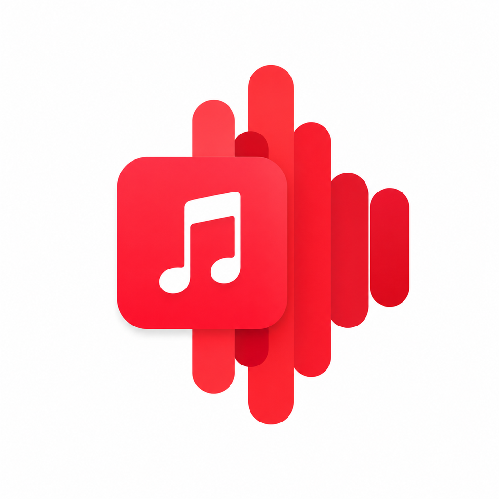

<div align="center">
  

  # Lyriam

  **音乐歌词与系统活动灵动岛** — macOS 菜单栏应用

  
  
  
</div>


## 特性

### 核心功能
- **实时同步歌词** — 从网易云音乐 API 获取 LRC 格式歌词，精确同步当前播放位置
- **灵动岛浮窗** — 模拟 Apple Dynamic Island 风格，浮于屏幕顶部菜单栏区域
- **两种布局模式**
  - *靠左 · 尽量不遮挡右侧 App* — 宽左翼展示歌词，右侧留给系统图标
  - *摄像头居中 · 对称* — 紧凑设计，左右两翼围绕摄像头刘海，歌词居中显示
- **展开卡片** — 悬停灵动岛展开完整播放器界面，显示封面、歌名、艺术家、进度条、播放控制、同步歌词面板
- **自定义外观**
  - 字体选择（系统字体或已安装字体族）
  - 字号调整（12-32pt）
  - 滚动速度控制（10-80 pt/s）
  - 颜色模式（跟随封面主题色 / 自定义色）
### 音乐与歌词
- Apple Music 播放控制、封面、同步歌词与紧凑波形。
- 恢复已安装 0.1.0 版的黑色区域位置、尺寸、刘海间距和轮廓；展开状态保留原来的菜单栏透明留白，新增内容使用原有空间。
- 展开卡片提供 Music、Controls、Headphones、Clipboard、Files、倒计时、便签待办、小镜子入口。
- 收起状态的活动图标和数字使用向内留白，展开封面放大为 168 pt，歌词在歌词区域居中显示；黑色区域轮廓和窗口位置保持原版。
- 保留字体、颜色、字号、滚动速度、悬停和手势设置。

### 系统活动
- **音量 / 亮度**：以 Volume / Brightness 英文标签显示真实百分比与平滑进度条，提示结束后恢复歌词；Controls 页使用固定深色外观与高对比度文字，可拖动滑块。
- 音量跟随当前系统音频输出；内置屏幕亮度通过运行时系统接口读取，不支持的设备显示不可用。
- 支持接管系统音量、静音与亮度媒体键：在 Settings → Activities 开启“接管系统音量和亮度提示”，并由用户授权辅助功能后生效。只有硬件调整成功且灵动岛可显示时才消耗按键；全屏、锁屏、权限缺失及不支持的硬件自动使用系统控制。
- 常规按键按 1/16 档位调节，Shift + Option 使用 1/64 细调。内置屏幕原生背光档位转换到键盘滑块刻度，百分比按四舍五入显示；每次按键触发图标动效，继续向 0% / 100% 外调节时显示当前值并轻抖内容。黑色背景轮廓不参与抖动。
- 亮度无法区分所有变化来源，大幅自动亮度调整也可能出现提示。
- **蓝牙耳机**：AirPods 和其他蓝牙耳机连接时，在岛的下方弹出独立浅色卡片，展示系统蓝牙名称、连接状态与可用电量；自动收起，也可手动关闭。AirPods 使用匹配型号的真实产品循环旋转视频，右侧充电盒固定，电量对应左右耳及充电盒；未知品牌使用通用耳机图标。卡片不改变灵动岛原有轮廓。
- 电量只在系统提供实际数值时显示；AirPods 左右耳、充电盒读数属于可选系统能力，缺失时省略。此版本不提供开盖发现、降噪切换或设备配对。
- **充电提示**：接通 / 断开电源时显示真实电量，使用蓝色进度条与流动高光。
- **Caps Lock 与网络提示**：切换大写锁定、网络连接或断开时短暂显示；网络切换经过防抖，首次启动不弹出初始状态。

### 快捷工具
- **剪贴板**：⌃⌥V 打开，直接显示文字与图片历史，支持图片缩略图与预览、重新复制、固定、移除、暂停和清空。搜索框已移除。PNG / TIFF 图像以实际图片格式复制回剪贴板。
- 保留 20 条普通内容与最多 20 条固定内容，另有图片与总内存上限；历史仅在内存中保存，退出后清空。不会导入启动前的剪贴板，跳过声明为敏感或临时的格式。
- **文件暂存**：将文件拖到岛上自动展开，支持拖出、双击打开、右键在 Finder 显示、移除。最多 24 个引用，保存文件书签以便重启恢复；不会移动或删除原文件。
- 用法示例：从 Finder 拖入 → 切到微信、邮件或浏览器 → 从岛上拖出作为附件或上传。可在设置中关闭此功能。
- Settings → Activities 可分别开关提示和工具。
- **倒计时**：中文闹钟式界面，1 / 5 / 10 分钟预设或自定义时、分、秒，支持暂停、继续与重置。截止时间保存在本地，睡眠后准确恢复，到点提示并播放轻提示音。
- **便签与待办**：文字自动保存在本机，支持添加、完成、删除待办和撤销最近一次删除。
- **摄像头小镜子**：中文界面、520 × 174 pt 镜像预览，使用原有展开区域。点击“开启摄像头”后才请求权限并开始预览。离开页面、收起、隐藏或锁屏时停止；不使用麦克风、不录制、不上传。

### 网络与锁屏
- 展开后的工具栏显示检测到的出口地区与这台 Mac 的实时上下行速率；独立 Network 页面已删除。收起状态不显示网络信息，也不读取流量或请求地区。
- 不需要 OpenClash API 或路由器凭据。流量来自本机活动物理接口；出口由一个小型 HTTPS 请求通过 `ipwho.is` 查询，缓存五分钟。分流规则会使不同网站的出口不同，因此这里显示检测请求的出口地区，不冒充路由器选择的节点名称。
- 锁屏音乐使用独立音乐卡片，只显示封面、歌名、艺人和播放控制。主岛及私人内容在锁定、换用户、屏幕休眠时隐藏；解锁恢复。
- 锁屏窗口使用公开 AppKit API，锁定状态使用系统会话信息与通知。真实锁屏显示和摄像头画面仍需在目标 macOS 环境中确认。

### 窗口行为
- 全屏应用与无边框全屏视频隐藏岛，退出后恢复；手动隐藏状态不会被自动恢复覆盖。
- 岛固定在启动时选中的显示器，切换前台应用不会移动黑色区域；只有原显示器断开才选择替代屏幕。
- 展开和收起使用 Core Animation 合成约 300 ms 的可中断动画，SwiftUI 只布局最终尺寸；所有页面固定在原有展开区域，避免摄像头原生视图撑大窗口。减少动态效果开启时采用即时切换。
- 参考 [Alcove](https://www.tryalcove.com/) 的克制交互与 [AirBuddy 3](https://v3.airbuddy.app/) 的设备状态组织。代码独立实现。

## 安装

### 从 .dmg 安装
1. 下载最新的 `Lyriam.dmg`
2. 打开 DMG，拖动 `Lyriam.app` 到 **应用程序** 文件夹
3. 首次启动时，macOS 会要求允许 Apple Events 访问权限（用于读取 Music.app）
4. 点击菜单栏的音乐符号图标，选择**设置**或按 **⌘,** 配置选项

### 从源码编译
```bash
git clone https://github.com/DonVitsch/Lyriam.git
cd Lyriam
./build.sh
open build/Lyriam.app
```

**要求:**
- macOS 14.0 或更新版本
- Swift 5.9+ (通常预装于 Xcode)
- 命令行工具: `xcode-select --install`

## 使用

### 基础操作
1. **打开应用** — 双击 Lyriam.app（或从应用程序文件夹启动）
2. **启动 Apple Music** — 播放歌曲
3. **查看歌词** — 灵动岛会显示当前歌词，随着音乐进度实时更新
4. **展开卡片** — 点击岛展开，或在设置中开启悬停展开
5. **固定浮窗** — 点击展开卡片右上角的图钉按钮固定浮窗（不会因鼠标移开而折叠）
6. **打开设置** — 按 **⌘,** 或点击展开卡片的齿轮⚙️按钮

## 开发

### 项目结构
```
Lyriam/
├── Sources/
│   ├── App/                    # 应用入口、菜单栏、全局热键
│   ├── Settings/               # 配置模型和持久化存储
│   ├── NowPlaying/             # Music.app 播放信息监听
│   ├── Lyrics/                 # 网易云 API、LRC 解析、缓存
│   └── UI/                     # SwiftUI 界面组件
│       ├── Notch/              # 浮窗、灵动岛布局
│       └── Settings/           # 设置界面
├── Resources/                  # 应用图标
├── Info.plist                  # 应用配置
├── build.sh                    # 编译脚本
└── README.md                   # 本文件
```

### 编译和开发
```bash
# 编译
./build.sh

# 启动（开发调试）
open build/Lyriam.app

# 安装到应用程序文件夹
cp -R build/Lyriam.app /Applications/
```

### 依赖
- **Foundation** — 网络请求、文件系统、定时器
- **AppKit** — 窗口、菜单栏、Dock 控制
- **SwiftUI** — UI 布局和动画
- **Combine** — 响应式数据绑定

### 关键组件
| 文件 | 职责 |
|------|------|
| `NowPlayingMonitor.swift` | 通过 AppleScript 轮询 Music.app 当前播放信息 |
| `RemoteLyricsSource.swift` | 查询网易云 API、获取 LRC 歌词 |
| `LyricsRepository.swift` | 内存 + 磁盘缓存、避免重复查询 |
| `LyricsSyncEngine.swift` | 驱动每 0.2s 检查当前歌词行索引 |
| `NotchPanel.swift` | NSPanel 浮窗、几何计算、全屏检测 |
| `NotchView.swift` | SwiftUI 主界面（collapsed bar + expanded card） |

## 当前开发版本与回滚

当前本地功能版本为 **0.6.0**，构建输出在 `build/Lyriam.app`。运行新版无需覆盖 `/Applications/Lyriam.app`。

本轮修改前的 0.5.0 源码和 App 分别保存在 `.rollback/2026-10-10/Lyriam-v0.5.0-before-animation-source.tar.gz` 与 `Lyriam-v0.5.0-before-animation.zip`，可解压到新目录运行或继续开发。

旧安装版 0.1.0 对应源码、开始开发前的未提交源码、Git 历史与已安装 App 保存在 `.rollback/2026-10-10/`。恢复旧安装版源码时，在空目录解压 `Lyriam-v0.1.0-source.tar.gz`；`Lyriam-source-before-features.tar.gz` 则是开始开发时的未提交源码，两者轮廓不同。恢复旧 App 时解压 `Lyriam-installed-before-features.zip` 并运行。

蓝牙被系统拒绝时，请在“系统设置 → 隐私与安全性 → 蓝牙”允许 Lyriam。没有耳机实物连接时，无法验证特定型号电量和连接延迟；普通蓝牙设备是否提供电量取决于设备与 macOS。

## 产品动画素材

`Resources/Headphones` 的 AirPods 旋转视频和静态图来自 [AirPodsDesktop](https://github.com/SpriteOvO/AirPodsDesktop) 的产品动画素材，经裁切、去底色、缩放及转码生成。原项目采用 GPL-3.0，相关资源保留该许可，副本位于 `Resources/Headphones/AirPodsDesktop-LICENSE.txt`。Lyriam 的 MIT 代码许可不覆盖这些第三方素材。
